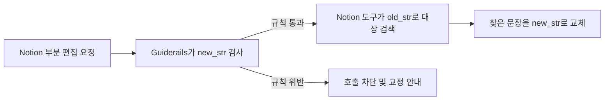
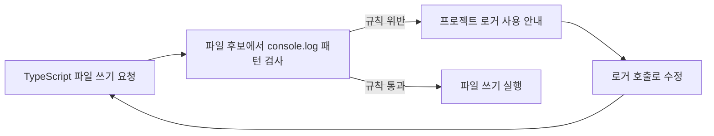

# Hermes Agent용 Guiderails

[English](README.md)

## 소개

Guiderails는 Hermes Agent의 도구 호출을 실행 전에 검사하는 플러그인입니다. 프로필별 규칙으로 도구 인자와 로컬 파일에 기록될 내용을 검사하고, 규칙에 지정된 교정 방법을 다음 모델 요청의 `<guiderails>` 블록에 전달합니다.

## 문제 정의 및 사용 사례

이 플러그인은 `백곰 효과`를 막기 위해 고안되었습니다. 모델은 문서 작성 지시에서 특정 표현을 피하라고 해도 파일이나 Notion에 같은 표현을 다시 쓸 수 있습니다. 프로젝트에서 정한 로거 대신 `console.log(...)`를 쓰는 경우도 마찬가지입니당. Guiderails는 이런 반복을 도구 호출 시점에 감지해 저장 전에 무엇을 바꿔야 하는지 모델에 알려줍니다.

아래 사례는 해당 규칙이 활성화되어 있고 `strict` 모드의 거절 한도가 남은 경우를 설명합니다. `<guiderails>` 블록은 호출이 차단된 뒤 다음 모델 요청에 들어가는 교정 안내 예시입니다. 내용을 수정해 다시 호출할지는 모델이 결정합니다.

### 사례 1: 파일 편집에서 모호한 기한 교정

작업 문서를 편집할 때 [`ko.avoid-vague-timing`](examples/patterns/ko.avoid-vague-timing.yaml) 규칙은 `artifact.text`로 편집 후 파일에 들어갈 전체 내용을 검사합니다. 예시 규칙은 `가능한 한 빨리`를 감지하므로, 편집에서 건드리지 않은 기존 문장에 이 표현이 남아 있어도 걸릴 수 있습니다.

```text
<guiderails>
Guiderails correction (ko.avoid-vague-timing): The call was blocked because it violated a rule.
Rule: 문서에서 '가능한 한 빨리'는 기한을 모호하게 표현합니다.
How to fix it: 확인된 기한을 '금요일 17시까지 처리한다'처럼 쓰세요. 기한을 모르면 기한이 미정임을 명시하세요.
Submit the corrected call in the same turn or continue with independent read operations.
</guiderails>
```

기한이 정해졌다면 `가능한 한 빨리 처리한다.`를 `금요일 17시까지 처리한다.`로 바꿉니다. 기한을 확인할 수 없다면 `처리 기한은 미정입니다.`라고 명시합니다.

### 사례 2: Notion에 작성할 본문 교정

Notion MCP 도구에는 [`ko.avoid-meaning-disclaimer`](examples/patterns/ko.avoid-meaning-disclaimer.yaml) 규칙을 적용할 수 있습니다. 이 규칙은 페이지 생성 시 `/pages/*/content`, 부분 편집 시 `/new_str`과 `/content_updates/*/new_str` 등 페이지에 넣을 텍스트를 검사합니다. 아래는 `content_updates`로 기존 문장을 교체하는 경우입니다.



```text
<guiderails>
Guiderails correction (ko.avoid-meaning-disclaimer): The call was blocked because it violated a rule.
Rule: '검토는 끝났다. 공식 승인을 뜻하지 않는다'처럼 앞 진술의 의미를 뒤에서 부정하는 표현을 쓰지 않습니다.
How to fix it: 앞 진술의 의미를 뒤에서 부정하거나, 한정, 또는 면책하는 표현을 쓰지 않습니다. 대신, 진술의 의미를 그대로 표현하세요.
Submit the corrected call in the same turn or continue with independent read operations.
</guiderails>
```

### 사례 3: 프로젝트 로거 사용 유도

TypeScript 프로젝트에서 로깅을 공통 모듈로 처리한다면 `console.log(...)`를 감지하는 사용자 정의 `artifact.text` 규칙을 추가할 수 있습니다. 교정 지침에는 해당 프로젝트의 로거와 사용법을 명시합니다.



사용자 정의 규칙의 ID를 `ts.use-project-logger`로 정했다면 모델에 다음과 같은 안내를 전달할 수 있습니다.

```text
<guiderails>
Guiderails correction (ts.use-project-logger): The call was blocked because it violated a rule.
Rule: 이 프로젝트에서는 TypeScript 코드의 로그를 공통 로거로 기록합니다.
How to fix it: console.log(...)를 logger.info(...)로 바꾸고, 필요한 경우 프로젝트의 로거 모듈에서 logger를 가져오세요.
Submit the corrected call in the same turn or continue with independent read operations.
</guiderails>
```

예를 들어 `console.log('동기화 완료')`를 프로젝트에서 쓰는 `logger.info('동기화 완료')`로 바꾸고, 필요한 import를 추가해 다시 요청할 수 있습니다. 문자열이나 주석에도 같은 패턴이 들어갈 수 있으므로 규칙을 활성화하기 전에 실제 코드와 예외 사례로 감지 범위를 확인합니다.

## 핵심 기능

### 검사 대상과 규칙 관리

- `artifact.text`는 지원되는 파일 후보를 검사합니다. 로컬 쓰기와 편집에는 절대경로 또는 `~/` 경로를 사용합니다.
- `tool.arguments`는 도구로 전달되는 인자를 검사합니다. 원격 도구와 동적 산출물을 만드는 도구의 규칙은 Hermes가 실행 전에 받는 인자를 기준으로 작성합니다. `arguments` 목록에서 도구 이름과 `/pages/*/content` 같은 인자 경로를 선택할 수 있습니다. 감사 기록에는 `/pages/1/content`처럼 실제로 일치한 경로가 남습니다.
- `/guiderails propose <요청>`으로 비활성 규칙 초안을 만들 수 있습니다. 검토한 초안은 `/guiderails approve <draft_id> <digest>`로 활성화합니다.

### 차단과 교정 안내

- `strict` 모드는 세션마다 규칙별로 `max_rejections`회(기본 3회)까지 일치한 호출을 차단합니다. 한도에 도달하면 경고를 붙이고 호출을 진행합니다. `0`으로 설정하면 첫 일치부터 경고만 붙입니다.
- `observe` 모드는 규칙에 일치한 내역을 기록하고 호출을 진행합니다. 잘못된 호출 구조나 설정된 효과 정책에 의해 거절된 호출은 두 모드에서 차단할 수 있습니다.
- 기본값 `keep: true`는 거절된 호출의 실패 결과를 보존합니다. `keep: false`는 다음 모델 요청에서 거절된 호출과 그 결과를 제외하면서 같은 배치의 다른 호출과 교정 안내는 유지합니다.

### 알림과 감사 기록

`strict` 모드에서 차단한 호출은 `Guiderails · BLOCKED · <도구> · <이벤트 접두어>`로 표시합니다. 호출의 첫 경고는 `WARNED`로 표시합니다. 지원되는 Ink 세션에서는 실행 중 대화에 알림을 표시하고, 메시징 플랫폼에는 Hermes의 공개 `post_message`로 전달합니다.

감지와 판정을 SQLite에 함께 저장합니다. JSONL 내보내기에 실패한 이벤트는 아웃박스에 남기고, 다음 감지나 `/guiderails status` 실행 시 저장 순서대로 다시 내보냅니다. 아웃박스가 가득 찬 상태에서 새 감지가 발생하면 기존 이벤트를 먼저 내보내려고 시도합니다.

## 설치

Linux 또는 macOS에 [Hermes Agent](https://github.com/NousResearch/hermes-agent)를 설치한 환경에서 사용합니다. 네이티브 시험 기준은 Python 3.11과 Hermes `caafe5389ae585ef77387a962aee05b1bcf17029`입니다. Hermes 플러그인 ID는 `guiderails`입니다.

**복사해서 에이전트에 전달**

```text
로컬 Hermes 프로필 <profile>에 Guiderails를 설치해줘. https://github.com/miyu4u/hermes-guide-rails.git 을 클론하고 plugin.yaml, __init__.py, src/guiderails를 검토한 뒤 HEAD를 기록해. hermes --version 및 hermes --profile <profile> config path로 런타임과 프로필 경로를 확인해 줘. 이 README에 따라 검토한 로컬 클론의 SHA로 설치해줘. 프로필 경로, 설치 리비전, 활성 상태, 의존성 및 로드 확인 결과를 알려줘. 기존 프로필의 설정과 규칙은 보존하고 예시는 테스트 프로필에서 사용해 줘.
```

저장소를 클론하고 커밋된 파일을 검토합니다.

```sh
git clone https://github.com/miyu4u/hermes-guide-rails.git
cd hermes-guide-rails
checkout=$(pwd -P)
revision=$(git rev-parse HEAD)
git show --stat "$revision"
```

기존 프로필을 선택하거나 `hermes profile create guiderails-test`로 테스트용 프로필을 만듭니다. 검토한 클론에서 `profile`을 대상 이름으로 지정하고 실행합니다.

```sh
profile=guiderails-test
hermes --version
config_path=$(hermes --profile "$profile" config path)
printf 'Profile config: %s\n' "$config_path"
```

출력 경로가 대상 프로필에 속하는지 확인합니다. 설정 파일이 있는 디렉터리가 프로필 홈입니다.

설치 전에 `hermes --profile "$profile" plugins list --user`로 기존 `guiderails` 항목을 확인합니다. 다음 명령으로 로컬 클론에서 검토한 Git 커밋을 설치하고 활성화하며 Hermes 환경에 매니페스트의 Python 의존성(`regex`, `PyYAML`, `jsonschema`)을 설치하는 데 동의합니다.

```sh
hermes --profile "$profile" plugins install "file://$checkout" \
  --ref "$revision" --enable --yes-deps
hermes --profile "$profile" plugins list --user --enabled --json
hermes --profile "$profile" plugins doctor guiderails --ci
```

`guiderails` 상태가 `enabled`이고 `git pinned@…`의 커밋 접두어가 `$revision`과 일치하는지 확인합니다. `doctor` 출력에서 플러그인 로드와 등록 결과를 확인합니다. 이 검사에서 실제 Hermes 런타임이 선언된 의존성을 가져옵니다. 의존성이 빠져 있다면 `hermes --profile "$profile" pm status`를 확인하고 환경 문제를 해결합니다. 설치 후 해당 프로필의 실행 중인 Hermes 세션을 다시 시작합니다.

## 설정 및 검증

### 프로필에 설정과 규칙 적용

[예시 config.yaml](examples/config.yaml)을 `<profile-home>/guiderails/config.yaml`에 복사하고, 사용할 [예시 규칙 파일](examples/README.md)을 `<profile-home>/guiderails/patterns/`에 복사합니다. 필요한 디렉터리를 만들고, 기존 프로필에서는 설정 키와 규칙 ID를 기준으로 병합합니다. 설정 변경은 새 플러그인 런타임에서 반영됩니다. `/guiderails reload`는 규칙 파일을 갱신합니다.

규칙 문서 형식은 [v1 JSON 스키마](src/guiderails/schemas/pattern-set.v1.schema.json)에 정의되어 있습니다. `logging.max_outbox`의 최솟값은 2입니다.

### 차단과 교정 확인

1. `hermes --profile "$profile"`을 실행하고 `/guiderails status`, `/guiderails list`, `/guiderails test ko.avoid-vague-timing`으로 플러그인 상태와 예시 규칙을 확인합니다.
2. 모델을 설정한 프로필에서 새 `strict` 세션을 엽니다. 임시 디렉터리 아래의 쓰기 가능한 새 절대경로에 `가능한 한 빨리 처리한다.`를 저장하도록 `write_file` 호출을 요청합니다. 호출이 차단되고 교정 안내가 표시되는지 확인합니다.
3. 같은 경로에 `금요일 17시까지 처리한다.`를 저장하도록 다시 요청하고 파일 내용을 확인합니다. `/guiderails stats`와 `/guiderails report`에서 감지 이력을 조회합니다.

## 제거 및 제약 사항

### 플러그인과 프로필 데이터 제거

```sh
hermes --profile "$profile" plugins disable guiderails
hermes --profile "$profile" plugins remove guiderails
hermes --profile "$profile" plugins list --user
```

새 Hermes 세션에서 플러그인이 제거됐는지 확인합니다. 프로필 데이터도 지우려면 보존할 항목을 백업하고 `<profile-home>/guiderails/`를 삭제합니다. 이 디렉터리에는 설정, 규칙, 초안, SQLite 상태, 감사 이력이 들어 있습니다.

### 운영 제약

> ! 주의 ! 거절에 대한 예산을 무한대에 가깝게 지정해선 안됩니다. 도구 호출을 이상하게 계속 반복하거나, 기상천외한 방법으로 작업을 어떻게든 완수하려고 할 수도 있습니다. 문제가 생기면 다른 조정 방법이 필요합니다.

- 도입 전 검토해야합니다 : Guiderails는 실험적 플러그인입니다. 사용자는 도입 전에 플러그인을 검토하고, 에이전트는 설치 전에 사용자에게 검토 여부를 묻습니다.
- 검사 범위와 오류 처리의 제한 :  Guiderails는 모델의 도구 사용을 교정하는 용도로 설계되었습니다. 접근 제어는 Hermes와 대상 시스템의 권한 설정에 맡깁니다. 위반을 확인하기 전에 검사 자원 한도에 도달하면 Hermes는 호출을 실행하고 `Guiderails · BYPASSED · Inspection budget exceeded`를 표시할 수 있습니다. 플러그인 오류로 검사나 판정 저장을 마치지 못해도 Hermes는 호출을 계속 처리합니다. 교정 안내를 붙이는 중 오류가 나면 Hermes는 원래 모델 요청으로 대화를 이어갑니다.
- 알림 지원 범위에 제한이 있음 -> 검증은 주로 TUI에서 이루어졌습니다. TUI 알림은 Hermes v23.4 기준 공개 문서에 명시되지 않은 API를 사용합니다. 현재 상태 표시줄에서 동작을 확인할 수 있으며 더 눈에 띄는 표시를 지원하려면 업스트림 API가 필요합니다. 메신저와 웹 앱의 알림 표시는 각 클라이언트의 `post_message` 구현에 따릅니다.
- 알림 전달의 제한 :  이벤트당 전송을 한 번 시도합니다. Discord의 후속 히스토리 수집은 알림을 채팅 메시지로 처리할 수 있습니다. Hermes 프로필에서 `logging.level: DEBUG`를 적용하면 `logs/agent.log`에서 알림 전달 실패를 확인할 수 있습니다.

## Inspired

이 프로젝트는 omp의 [ttsr](https://omp.sh/docs/ttsr) 에 영향을 받았습니다. 멋진 기능이에요.

## 라이선스

[MIT](LICENSE)
