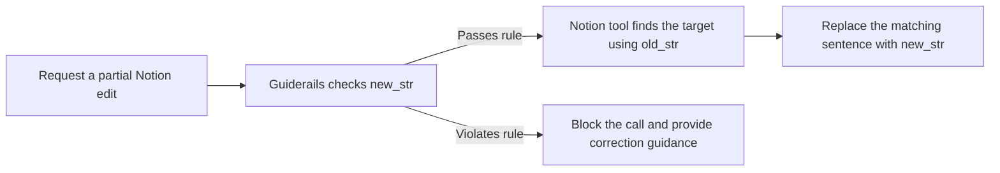
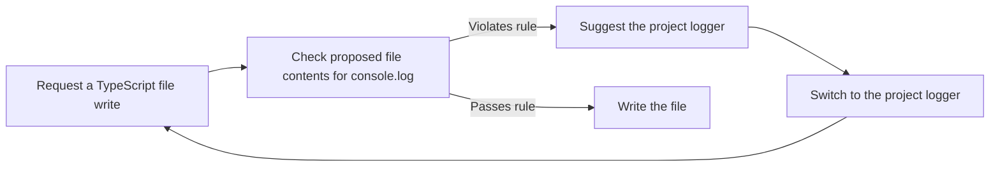

# Guiderails for Hermes Agent

[한국어](README.ko.md)

## Introduction

Guiderails is a Hermes Agent plugin that checks tool calls before execution. It applies profile-specific rules to tool arguments and proposed local file contents, then sends any correction specified by the rule in a `<guiderails>` block in the next model request.

## Problem and use cases

Guiderails was designed to address the “white bear effect”: a model can write a phrase in a file or Notion page even after being instructed to avoid it. A model can similarly use `console.log(...)` where a project requires a shared logger. Guiderails detects these patterns in the tool call and tells the model what to change before the content is saved.

These examples assume the relevant rule is active and has rejections remaining in `strict` mode. Each `<guiderails>` block shows the correction sent in the next model request after a blocked call. The model decides whether to revise and retry the call. The Korean text inside the blocks is the rule-specific content the model receives.

### Example 1: Replace a vague deadline in a file

When you edit a task document, the [`ko.avoid-vague-timing`](examples/patterns/ko.avoid-vague-timing.yaml) rule uses `artifact.text` to inspect the entire file as it would appear after the edit. The rule matches `가능한 한 빨리` (“as soon as possible”), including any existing sentence the edit leaves unchanged.

```text
<guiderails>
Guiderails correction (ko.avoid-vague-timing): The call was blocked because it violated a rule.
Rule: 문서에서 '가능한 한 빨리'는 기한을 모호하게 표현합니다.
How to fix it: 확인된 기한을 '금요일 17시까지 처리한다'처럼 쓰세요. 기한을 모르면 기한이 미정임을 명시하세요.
Submit the corrected call in the same turn or continue with independent read operations.
</guiderails>
```

If the deadline is known, replace `가능한 한 빨리 처리한다.` (“Handle this as soon as possible.”) with `금요일 17시까지 처리한다.` (“Handle this by Friday at 17:00.”). If you cannot confirm a deadline, write `처리 기한은 미정입니다.` (“The deadline has yet to be determined.”).

### Example 2: Correct text before writing to Notion

Apply the [`ko.avoid-meaning-disclaimer`](examples/patterns/ko.avoid-meaning-disclaimer.yaml) rule to Notion MCP calls. It checks text destined for the page, including `/pages/*/content` on page creation and `/new_str` or `/content_updates/*/new_str` on partial edits. This example uses `content_updates` to replace an existing sentence.



```text
<guiderails>
Guiderails correction (ko.avoid-meaning-disclaimer): The call was blocked because it violated a rule.
Rule: '검토는 끝났다. 공식 승인을 뜻하지 않는다'처럼 앞 진술의 의미를 뒤에서 부정하는 표현을 쓰지 않습니다.
How to fix it: 앞 진술의 의미를 뒤에서 부정하거나, 한정, 또는 면책하는 표현을 쓰지 않습니다. 대신, 진술의 의미를 그대로 표현하세요.
Submit the corrected call in the same turn or continue with independent read operations.
</guiderails>
```

### Example 3: Use the project's shared logger

If a TypeScript project uses a shared logging module, add a custom `artifact.text` rule that matches `console.log(...)`. In the correction guidance, name the project logger and explain how to use it.



A custom rule with the ID `ts.use-project-logger` could send this guidance:

```text
<guiderails>
Guiderails correction (ts.use-project-logger): The call was blocked because it violated a rule.
Rule: 이 프로젝트에서는 TypeScript 코드의 로그를 공통 로거로 기록합니다.
How to fix it: console.log(...)를 logger.info(...)로 바꾸고, 필요한 경우 프로젝트의 로거 모듈에서 logger를 가져오세요.
Submit the corrected call in the same turn or continue with independent read operations.
</guiderails>
```

For example, replace `console.log('동기화 완료')` with the project's `logger.info('동기화 완료')`, add the required import, and retry the call. The pattern may also match strings or comments, so check the rule against real code and exceptions before activating it.

## Core features

### Inspection targets and rule management

- `artifact.text` inspects supported file candidates. Use absolute or `~/` paths for local writes and edits.
- `tool.arguments` inspects the arguments passed to a tool. For remote tools and tools that produce dynamic output, write rules against the arguments Hermes receives before execution. An `arguments` list can select tool names and paths such as `/pages/*/content`; audit entries record concrete paths such as `/pages/1/content`.
- `/guiderails propose <request>` creates an inactive rule draft. Review it, then use `/guiderails approve <draft_id> <digest>` to activate it.

### Blocking and correction guidance

- In `strict` mode, each rule can reject up to `max_rejections` matching calls per session (default: 3). After the limit is reached, matching calls proceed with a warning. Set `max_rejections` to `0` to warn from the first match.
- In `observe` mode, Guiderails records rule matches and lets the call proceed. Either mode can block malformed calls or calls denied by the configured effect policy.
- With the default `keep: true`, rejected calls retain their failure result. With `keep: false`, the next model request omits the rejected call and its result while retaining the other calls in the batch and the correction guidance.

### Notifications and audit records

A call blocked in `strict` mode can produce a `Guiderails · BLOCKED · <tool> · <event prefix>` notice. The first warning for a call uses `WARNED`. Supported Ink sessions display the notice during the turn. Messaging platforms receive it through Hermes' public `post_message` API.

SQLite stores detections and decisions together. If a JSONL export fails, the event stays in the outbox. A later detection or a command such as `/guiderails status` retries exports in insertion order. If the outbox is full when a new match is detected, Guiderails tries to export the backlog first.

## Installation

Use Linux or macOS with [Hermes Agent](https://github.com/NousResearch/hermes-agent) installed. The native test target is Hermes `caafe5389ae585ef77387a962aee05b1bcf17029` on Python 3.11. The Hermes plugin ID is `guiderails`.

**Copyable agent handoff**

```text
Install Guiderails into my local Hermes profile <profile>. Clone https://github.com/miyu4u/hermes-guide-rails.git, inspect plugin.yaml, __init__.py and src/guiderails, and record the reviewed HEAD. Use hermes --version and hermes --profile <profile> config path to confirm the runtime and profile home. Follow this README to install from that local checkout at the reviewed SHA. Report the profile path, installed revision, activation, and dependency/load check. Preserve existing profile configuration and rules. Use the examples in a test profile.
```

Clone and review the committed files.

```sh
git clone https://github.com/miyu4u/hermes-guide-rails.git
cd hermes-guide-rails
checkout=$(pwd -P)
revision=$(git rev-parse HEAD)
git show --stat "$revision"
```

Choose an existing profile, or create a disposable one with `hermes profile create guiderails-test`. Run the following from the inspected clone, setting `profile` to the intended name:

```sh
profile=guiderails-test
hermes --version
config_path=$(hermes --profile "$profile" config path)
printf 'Profile config: %s\n' "$config_path"
```

Confirm the printed path belongs to the intended profile. Its directory is the profile home. Check for an existing `guiderails` entry with `hermes --profile "$profile" plugins list --user` before installing. This command installs the reviewed Git commit from the local clone, enables it, and consents to the manifest's Python requirements (`regex`, `PyYAML`, and `jsonschema`) in Hermes's environment:

```sh
hermes --profile "$profile" plugins install "file://$checkout" \
  --ref "$revision" --enable --yes-deps
hermes --profile "$profile" plugins list --user --enabled --json
hermes --profile "$profile" plugins doctor guiderails --ci
```

Confirm that `guiderails` appears as `enabled`, its `git pinned@…` source matches the prefix of `$revision`, and `doctor` loads the plugin and reports its registrations. This exercises the Hermes runtime that imports the declared dependencies. If a dependency is missing, inspect `hermes --profile "$profile" pm status` and resolve the reported environment issue before proceeding. Reopen any running Hermes session for that profile after installation.

## Configure and verify

### Apply settings and rules to a profile

Copy [examples/config.yaml](examples/config.yaml) to `<profile-home>/guiderails/config.yaml` and the desired [example rule files](examples/README.md) to `<profile-home>/guiderails/patterns/`. Create the directories if needed. Merge settings and rules into an existing profile by key and rule ID. Configuration changes require a fresh plugin runtime; `/guiderails reload` refreshes rule files.

The [v1 JSON schema](src/guiderails/schemas/pattern-set.v1.schema.json) defines the rule file format. The minimum value for `logging.max_outbox` is 2.

### Verify blocking and correction

1. Start `hermes --profile "$profile"`. Run `/guiderails status`, `/guiderails list`, and `/guiderails test ko.avoid-vague-timing` to check the plugin and the example rule.
2. In a fresh `strict` session with a model configured, ask Hermes to use `write_file` to save `가능한 한 빨리 처리한다.` at a new, writable absolute path under a temporary directory. Confirm that Guiderails blocks the call and shows correction guidance.
3. Ask Hermes to save `금요일 17시까지 처리한다.` at the same path and verify the file contents. Use `/guiderails stats` and `/guiderails report` to view detection history.

## Removal and limitations

### Remove the plugin and profile data

```sh
hermes --profile "$profile" plugins disable guiderails
hermes --profile "$profile" plugins remove guiderails
hermes --profile "$profile" plugins list --user
```

Start a new Hermes session to verify that the plugin is gone. To remove its profile data too, back up anything you want to keep and delete `<profile-home>/guiderails/`. That directory holds settings, rules, drafts, SQLite state, and audit history.

### Operational limitations

> **Caution:** Avoid setting `max_rejections` so high that the limit is effectively unlimited. The model may repeatedly retry a blocked call or try unexpected ways to complete the task. If you see this behavior, use a different way to guide the model.

- **Review before use:** Guiderails is experimental. Review it before use. If an agent handles installation, it must ask whether you want to review the plugin before it installs it.
- **Inspection and failure behavior:** Guiderails helps the model correct its tool use. Hermes and the target system enforce access permissions. If inspection reaches a resource limit before confirming a violation, Hermes may run the call and show `Guiderails · BYPASSED · Inspection budget exceeded`. If an error prevents inspection or decision storage, Hermes continues handling the call. If Guiderails cannot attach correction guidance, Hermes continues with the original model request.
- **Notification support:** Testing has focused on the TUI, which uses an undocumented Hermes API for notifications as of v23.4. You can see Guiderails activity in the status bar. More visible notifications require upstream API support. Notification visibility in messaging platforms and web apps depends on each client's `post_message` implementation.
- **Notification delivery:** Guiderails attempts delivery once per event. Discord history backfill may treat notices as chat messages. Set `logging.level: DEBUG` in the Hermes profile to see delivery failures in `logs/agent.log`.

## Inspiration

This project was inspired by omp's [ttsr](https://omp.sh/docs/ttsr). It's a great feature.

## License

[MIT](LICENSE)
