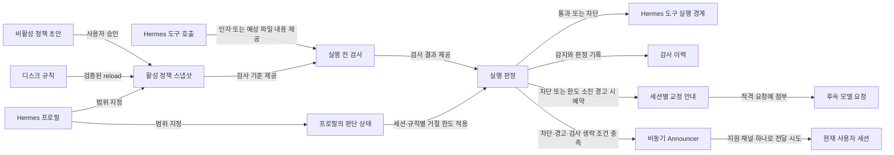
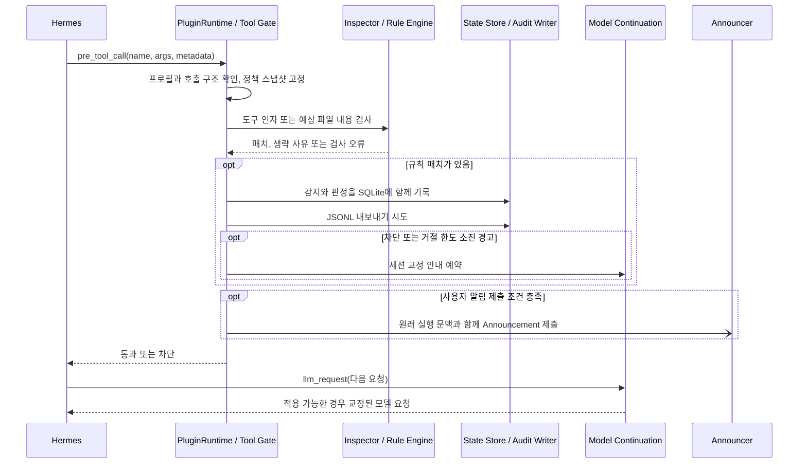

# 아키텍처

Guiderails는 Hermes가 도구 실행 여부를 정하기 직전에 현재 프로필의 규칙을 적용합니다. Hermes는 세션, 도구 실행, 모델 요청과 화면 표시를 소유합니다. Guiderails는 호출을 검사하고 판정을 기록하며, 상세 교정은 후속 모델 요청으로, 짧은 사용자 알림은 현재 세션으로 전달합니다.

## 구성과 생명주기

- **Hermes 연동과 프로필 생명주기**
  - **등록:** [PluginRuntime](../src/guiderails/plugin.py)은 `pre_tool_call` 훅, `llm_request` 미들웨어, `/guiderails` 명령, `guiderails_patterns` 도구와 unload 콜백을 등록합니다.
  - **프로필 확인과 초기화:** 호출 시 등록된 프로필 이름과 홈 경로를 확인하며, 관리자가 필요한 첫 호출에서 `PatternManager`를 초기화합니다.
  - **언로드:** 세션 교정 큐를 해제하고 관리자와 SQLite 연결을 닫습니다. 알림 워커는 전달을 시작하기 전에 런타임과 프로필 범위를 다시 확인합니다.
- **도구 실행 전 검사**
  - [ToolGate](../src/guiderails/tool_gate.py)는 호출마다 정책 스냅샷을 고정하고, 검사 결과를 Hermes가 해석하는 차단 또는 통과 결정으로 변환합니다.
  - [ToolInspector](../src/guiderails/adapters.py)는 검사할 인자 문자열과 로컬 파일 후보를 구성합니다. [호스트 어댑터](../src/guiderails/host.py)는 Hermes의 파일 네임스페이스를 확인합니다.
  - [RuleEngine](../src/guiderails/engine.py)은 규칙 범위와 인자 선택자를 적용하고, Unicode 정규화를 거쳐 인자 문자열이나 변경 후 파일 후보의 일치 결과를 반환합니다.
- **후속 모델 요청 교정**
  - [GuidanceFactory](../src/guiderails/guidance.py)는 차단·경고 문구, 도구 거절 응답과 `<guiderails>` 블록을 생성합니다.
  - [ModelContinuation](../src/guiderails/continuation.py)은 검사 과정에서 예약된 세션별 교정 안내를 관리하고, `llm_request`에서 후속 모델 요청을 재구성합니다.
- **사용자 세션 알림**
  - `PluginRuntime`은 차단·경고·검사 생략을 불변 [Announcement](../src/guiderails/announcement/contracts.py)로 만들어 [Announcer](../src/guiderails/announcement/announcer.py)에 제출합니다. `surface`는 검사 범위인 `tool.arguments`이며, 전달 목적지는 제출 시 복사한 Hermes 실행 문맥에서 결정합니다.
  - Announcer는 프로세스 공용 워커에서 `supports`가 처음 참인 채널의 `announce`를 호출합니다. 기본 순서는 [InkTranscriptChannel](../src/guiderails/announcement/channels/ink_transcript.py), [PostMessageChannel](../src/guiderails/announcement/channels/post_message.py)입니다. 검사 예산 알림은 같은 런타임·세션에서 대기하거나 전달 중인 건을 합칩니다.
- **정책 관리와 감사**
  - [PatternManager](../src/guiderails/manager.py)는 설정·규칙·초안·revision을 관리하고 규칙 엔진이 사용할 정책 스냅샷을 구성합니다.
  - [StateStore](../src/guiderails/state.py)는 감지·집계·거절 결정을 SQLite에 보관합니다. [AuditWriter](../src/guiderails/audit.py)는 미전송 이벤트를 JSONL로 내보냅니다.

## 의미적 설계 구조

활성 정책, 도구 호출, 판정과 두 안내 경로의 관계입니다.

## 호출부터 교정까지

직접 읽기와 허용된 관리 도구 동작은 일반 규칙 검사를 우회합니다. 일반 호출은 구조와 도구 효과를 먼저 확인한 뒤, 인자 문자열이나 실제 도구가 쓸 것으로 계산한 파일 내용을 검사합니다. 통과한 호출은 Hermes가 실행합니다. 파일 후보는 검사 시점의 예상 결과이며 검사와 실행을 하나의 파일 트랜잭션으로 묶지 않습니다.

## 정책 교체와 동시성

`propose`는 YAML을 검증해 비활성 초안으로 저장합니다. 사용자 명령 `approve`는 초안 ID와 digest를 확인한 뒤 관리 규칙의 새 후보를 적용합니다. `reload`는 디스크의 규칙을 다시 읽어 검증한 후 새 스냅샷을 게시합니다. 실패한 reload는 기존 스냅샷을 유지합니다. 호출은 시작 때 읽은 스냅샷으로 끝까지 검사하며, 감지 이벤트에도 해당 스냅샷의 digest를 남깁니다.

런타임 잠금은 프로필 확인과 정책 포착, 검사 결과를 반영하는 구간을 보호합니다. 파일 I/O와 규칙 검사는 잠금 밖에서 수행하며 결과를 반영하기 직전에 프로필과 수명을 다시 확인합니다. 규칙 엔진은 프로세스 공용 워커 8개와 슬롯 8개를 사용하고, 단일 검사에서 규칙을 최대 4개씩 병렬로 제출합니다. 파일 검사에도 별도 동시성 슬롯이 있습니다. 후보 바이트, 검사 기한, 정규식 시간, 매치 수 제한은 한 호출의 자원 사용을 제한합니다.

## 프로필 저장소와 복구

`<profile-home>/guiderails/`에 `config.yaml`, `patterns/`, `drafts/`, `state.sqlite3`, `audit/events.jsonl`과 회전본을 둡니다. SQLite는 감지 중복 방지, 집계, 거절 결정과 감사 outbox를 트랜잭션으로 관리합니다. 감사 작성기는 별도 파일 잠금 아래 JSONL을 동기화한 뒤 SQLite에서 해당 이벤트를 내보낸 것으로 표시합니다. 재시도 시 기존 이벤트 ID를 대조합니다.

관리 규칙 변경은 관리 잠금, `.pattern-change` 저널, 임시 파일의 원자적 교체를 사용합니다. 관리자는 초기화 시 저널과 SQLite 변경 기록을 대조해 중단된 작업을 복구합니다. 재시작 복구 범위는 저장된 감사와 정책 변경으로 한정되며, 모델 교정 큐와 사용자 알림은 프로세스 메모리에서 관리합니다.
